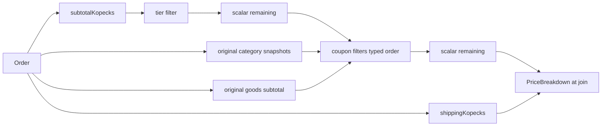
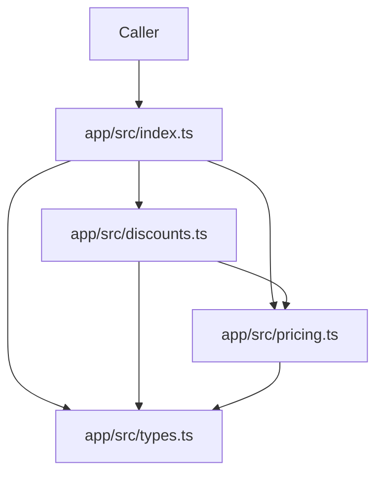

# Architecture Spine — Checkout discounts (loyalty + coupons)

## Design Paradigm

**Pipes-and-filters.** The receipt is a pipeline of pure filters over integer kopiyky. Shipping is a sidecar, not a stage in the discount pipe.

| Stage | Lives in | Reads | Writes |
| --- | --- | --- | --- |
| Goods subtotal | `app/src/pricing.ts` | Order items | `subtotalKopecks` |
| Tier filter | `app/src/discounts.ts` via `tierPercent` | full goods subtotal | `tierDiscountKopecks`; scalar remaining goods |
| Coupon filters (typed order) | `app/src/discounts.ts` | scalar remaining; original goods subtotal (min); original category totals when category-bound | `couponDiscountKopecks`; scalar remaining goods |
| Shipping sidecar | `app/src/pricing.ts` | Order country + categories | `shippingKopecks` |
| Join | `app/src/discounts.ts` | remaining goods + shipping | `PriceBreakdown` once |

Module layers: `types.ts` (frozen shapes) → `pricing.ts` (frozen primitive filters) → `discounts.ts` (pipeline) → `index.ts` (barrel).



## Invariants & Rules

### AD-1 — Spec is arithmetic authority `[ADOPTED]`

- **Binds:** all
- **Prevents:** architecture or a later story reopening stacking, bases, rounding, expiry, matching, coupon-count cap, or silent-skip forks already closed as D-1 through D-28
- **Rule:** `docs/spec/pricing-discounts.md` wins over the PRD, this spine, the ticket, and the code. Cite D-ids and AC-ids; do not invent a second algorithm. If a PRD sentence and the spec disagree, follow the spec.

### AD-2 — In-process domain library `[ADOPTED]`

- **Binds:** all
- **Prevents:** wrapping `priceOrder` as HTTP, a worker, a DB-backed promo service, or a UI
- **Rule:** the increment is a pure TypeScript function in `app/`. No network, no filesystem, no extra infrastructure, no checkout screens.

### AD-3 — Single public discount surface `[ADOPTED]`

- **Binds:** FR-10
- **Prevents:** a second public API (`calculateDiscounts`, classes, default exports, per-code preview, skip-reason DTOs)
- **Rule:** the only discount exports are `priceOrder(order: Order, catalog: Coupon[], asOf: Date): PriceBreakdown` and `PriceBreakdown` from `app/src/discounts.ts`, re-exported from `app/src/index.ts`. `PriceBreakdown` lives in `discounts.ts`, not `types.ts`. Helpers stay module-private.

### AD-4 — Frozen seeded contract `[ADOPTED]`

- **Binds:** FR-1, FR-8, FR-10
- **Prevents:** forking `Order` / `LineItem` / `Coupon`, or a parallel subtotal/shipping/tier implementation
- **Rule:** do not change shapes in `app/src/types.ts` or signatures/behaviour in `app/src/pricing.ts`. The pipeline must call `subtotalKopecks`, `shippingKopecks`, `tierPercent`, and `lineTotalKopecks`. The half-up helper stays private in `discounts.ts`; do not extend `pricing.ts`.

### AD-5 — Dependency direction `[ADOPTED]`

- **Binds:** all
- **Prevents:** import cycles and pricing primitives depending on discounts
- **Rule:** dependencies point only inward: barrel → pipeline or primitives or types; pipeline → primitives or types; primitives → types. `pricing.ts` and `types.ts` must not import `discounts.ts`.



### AD-6 — Integer kopiyky `[ADOPTED]`

- **Binds:** FR-3, FR-8, FR-9
- **Prevents:** float amounts, `Math.round` on money, and a second rounding of the grand total
- **Rule:** every money field is an integer kopiyka. Percent → kopiyky uses spec §3 / D-4 (integer `product`, `trunc`, remainder ≥ 50). Fixed coupons are already integers. Do not round `totalKopecks` again.

### AD-7 — Deterministic clock `[ADOPTED]`

- **Binds:** FR-6, NFR determinism
- **Prevents:** flaky expiry, mutating the caller's clock, and two runs of the same cart producing different receipts
- **Rule:** `asOf` is required. The engine must not read `Date.now()`, do IO, use randomness, or mutate `asOf` (`setUTC*` / `setTime`). Same `Order` + catalog + `asOf` → same `PriceBreakdown`. Eligibility vs `expiresAt` is spec D-16 / D-17: ineligible when `asOf.getTime() >= Date.parse(expiresAt)` (equality included: on or after); date-only `YYYY-MM-DD` is that day 00:00:00.000 UTC; unparsable → silent skip.

### AD-8 — Silent skip, always return `[ADOPTED]`

- **Binds:** FR-5, FR-6, FR-7
- **Prevents:** thrown errors, Result/Either wrappers, and per-code rejection lists on the return type
- **Rule:** `priceOrder` always returns `PriceBreakdown`. Expired, unknown, unparsable, duplicate-after-first, min-failing, and wrong-category typed codes contribute 0 and do not stop later codes. Duplicate identity is `trim` + case-insensitive (D-14, D-15); first catalog row wins on case-duplicates. No skip-reason field on `PriceBreakdown`.

### AD-9 — Pipeline composition `[ADOPTED]`

- **Binds:** FR-1, FR-2, FR-4, FR-8
- **Prevents:** additive percents, coupon-before-tier, reordering typed codes, a best-of subset, a coupon-count cap, leftover category maps, and a filter framework
- **Rule:** apply the tier filter first on the full goods subtotal, then each eligible coupon in typed-code order after trim/case unique (D-15). Uncategorized coupons compute percent/fixed against remaining goods; category-bound coupons compute against original category goods (`lineTotalKopecks` snapshots), then both cap by remaining (D-1, D-3, D-5, D-9, D-10, D-20, D-28). `minSubtotalKopecks` compares to original `subtotalKopecks(order)`, including for category coupons (D-6, D-19). The pipe carries one integer `remaining` plus read-only original subtotal and original per-category snapshots — not a leftover map, split-line working cart, or per-SKU remainder. No coupon-count cap (D-27). Shipping never enters the discount pipe (D-2). Keep the pipeline in `priceOrder` plus private helpers in `discounts.ts`; do not add a class hierarchy or extra packages.

### AD-10 — Breakdown identities `[ADOPTED]`

- **Binds:** FR-8, FR-9, FR-10
- **Prevents:** folding shipping into remaining goods, negative money fields, a per-code discount array, and stages mutating a draft receipt
- **Rule:** `PriceBreakdown` has exactly six integer fields, all ≥ 0: `subtotalKopecks`, `tierDiscountKopecks`, `couponDiscountKopecks`, `remainingGoodsKopecks`, `shippingKopecks`, `totalKopecks`. Construct it once at join from stage numbers; stages do not mutate a draft DTO. Identities on the returned object: remaining goods = subtotal − tier − coupon ≥ 0; total = remaining goods + shipping; shipping equals `shippingKopecks(order)`. Empty `items` is all zeros.

### AD-11 — Caller-owned inputs, immutable `[ADOPTED]`

- **Binds:** FR-2, FR-4, FR-6, FR-10
- **Prevents:** the engine owning catalog CRUD, inventing wall-clock expiry, mutating caller objects, or cloning a working cart
- **Rule:** catalog contents, `asOf`, and how typed codes got onto `Order.coupons` belong to the caller. `priceOrder` must not mutate `Order`, line items, the catalog, or `asOf`. Do not clone-and-mutate a working `Order` / `LineItem[]`. The only engine-owned mutables are local numeric accumulators (`remaining`, running coupon total). Category bases are snapshots, not leftover line quantities.

### AD-12 — Canonical engine `[ADOPTED]`

- **Binds:** FR-10
- **Prevents:** treating `app/src/run-b/` as a second production API or merging its extra types into `PriceBreakdown`
- **Rule:** the production engine is `app/src/discounts.ts`. `app/src/run-b/` is a Task D A/B artifact only; do not re-export it from `index.ts`.

## Consistency Conventions

| Concern | Convention |
| --- | --- |
| Naming | Named exports only. Files: `types.ts`, `pricing.ts`, `discounts.ts`, `index.ts`. Tests colocated as `*.test.ts`. Money fields end in `Kopecks`. |
| Imports | NodeNext: relative imports use a `.js` extension from `.ts` sources. |
| Types | No `any`. `Order` / `LineItem` / `Coupon` only from `types.ts`. |
| Tests | `app/src/discounts.test.ts`; each `it(...)` title starts with `AC-N:` matching spec AC-1 through AC-17. Seeded eight `pricing.test.ts` tests stay green. |
| Config | `app/tsconfig.json`: `strict`, `noUncheckedIndexedAccess`, `noEmit`. Verify with `cd app && npm test` and `npm run typecheck`. |
| Errors | No thrown errors for typed codes (AD-8). No extra validator for catalog garbage (D-22) or dirty LineItems (negative price/quantity). |
| State | No shared mutable state. Pure function; remaining goods is a local integer. |
| Logging / auth / config | None in this module. No new PII fields. No telemetry. |

## Stack

| Name | Version |
| --- | --- |
| TypeScript | ^5.6.0 |
| Node.js | 22+ |
| vitest | ^2.1.0 |
| @types/node | ^22.10.0 |
| ECMAScript target/lib | ES2022 |
| module / moduleResolution | NodeNext |
| package type | module |
| runtime dependencies | none |

Pins are the committed `app/package.json` and `app/AGENTS.md` ranges. Do not bump TypeScript, vitest, `@types/node`, or the Node 22+ floor in this increment.

## Structural Seed

```text
app/
  package.json
  tsconfig.json
  src/
    types.ts          # frozen Order, LineItem, Coupon
    pricing.ts        # frozen line/subtotal/shipping/tierPercent
    discounts.ts      # priceOrder + PriceBreakdown
    discounts.test.ts # AC-1..AC-17
    pricing.test.ts   # seeded eight tests
    index.ts          # public barrel
```

No deployable process. The library is imported in-process. Checkout-host topology is not this altitude.

## Capability → Architecture Map

| Capability / Area | Lives in | Governed by |
| --- | --- | --- |
| FR-1 Tier discount on goods | `discounts.ts` calling `tierPercent` | AD-4, AD-9 |
| FR-2 Eligible typed codes, typed order | `discounts.ts` | AD-8, AD-9, AD-11 |
| FR-3 Percent and fixed coupons | `discounts.ts` | AD-6, AD-1 |
| FR-4 Min and category gates on original goods | `discounts.ts` | AD-1, AD-9, AD-11 |
| FR-5 Conservative code match | `discounts.ts` | AD-1, AD-8 |
| FR-6 Expiry via `asOf` | `discounts.ts` | AD-7 |
| FR-7 Always return; silent skip | `discounts.ts` | AD-8 |
| FR-8 Sequential stacking; split lines; goods-only | `discounts.ts` + `pricing.ts` | AD-9, AD-10 |
| FR-9 Floor remaining goods; empty order zeros | `discounts.ts` | AD-10 |
| FR-10 `priceOrder` public contract | `discounts.ts`, `index.ts` | AD-3, AD-4, AD-12 |
| NFR determinism / integer money | pipeline | AD-6, AD-7 |
| Compatibility with seeded tests | `pricing.ts` | AD-4 |

## Deferred

- Checkout-host deployment, environments, CI beyond `cd app && npm test`, and any cloud provider — this altitude is an in-process library (AD-2).
- Coupon catalog CRUD, persistence, usage caps, personal codes, redemption store.
- Checkout UI, skip-reason copy, analytics, telemetry, logging, auth.
- Catalog-garbage behaviour (spec D-22) and dirty LineItems (negative price/quantity) — unspecified by design; no extra validator.
- Upgrading TypeScript ^5.6.0, vitest ^2.1.0, `@types/node` ^22.10.0, or the Node 22+ floor to later majors — homework stack is frozen.
- Evolution of `app/src/run-b/` — Task D artifact, not this engine (AD-12).
- Next product increment (not this spine): UI and persistence so silent skips become visible.
